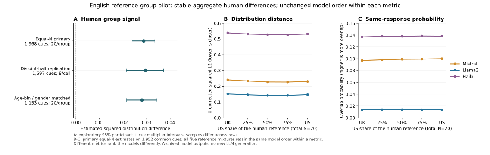

# 英美等样本联想pilot：群体差异可复现，模型排序未随参照组翻转

日期：2026-10-19。阶段：探索性pilot。**总决策：adjust。人类聚合差异通过预设门槛；“换一组人就改变模型排名”的强主张没有得到支持。进一步扩展前，应先校准人机评分。**

[首页](../README.md) · [分析前方案及修正记录](reference-group-pilot-plan-2026-10-19.md) · [完整聚合结果](../data/reference-group-pilot-2026-10-19.json) · [此前机会评估](postpilot-directions-2026-10-18.md)

左图三行的材料集合不同，不能据点的大小比较方法优劣；中、右图在相同1,952个提示词上比较，线条是首份固定平衡样本。两种评分各自的排序对参照组稳定，但彼此排序不同。全部区间与重复抽样范围见结构化结果。

## 1. 英美两组：相同人数下仍有可复现的平均差异

分组是自报母语英语变体`nativeLanguage`，不是直接按国籍或当前所在地分组。完整读取SWOW-EN18平衡表1,228,200行、12,282个提示词、83,864个参与者编号；按有效R1和不重复参与者资格保留**1,968个提示词，每词每组抽20人**，主样本共78,720条人类作答。缺失反应不补零，R2/R3不前移。原表1个重复“参与者—提示词”键的R1一致，确定性保留首条。

普通小样本分布距离即使在人群相同的情况下也往往大于零。本轮主要距离使用不含自配对的碰撞概率U统计量，估计两组反应概率分布的平方L2差，校正这一抽样偏差；单次估计允许为负。主要区间同时使用全局共享的参与者乘子和提示词乘子；同一人的多次作答不当作独立参与者。

| 检查 | 材料与人数 | 差异估计 | 探索性95%乘子区间 |
| --- | --- | ---: | --- |
| 主要平衡样本 | 1,968词；每组20人 | 0.02878 | [0.02385, 0.03351] |
| 不重叠参与者分半复现 | 1,697词；每个“组×半”8人 | 0.02958 | [0.02142, 0.03720] |
| 分半复现，另作作者拼写表归并 | 同上、同一批人 | 0.02962 | [0.02149, 0.03720] |
| 年龄段×性别组成匹配 | 1,153词；每组20人 | 0.02803 | [0.02153, 0.03438] |

分半检查先在每个变体组内将参与者全局分为互不重叠的A/B两半。跨半、不同组的经验距离均值为0.24803，跨半、同组为0.21845；两者之差0.02958等于两半的组差向量内积。因此，它反映同一差异方向在其他参与者中复现，不能由“每组只有8人，经验分布自然不同”单独解释。

500次重新等量抽20人的校正距离全部为正；其均值为0.02811，2.5%—97.5%范围为[0.02669, 0.02953]。这个范围是分配敏感性，不是总体置信区间，也不是500个独立实验。十个固定参与者分半的内积均为正，范围0.02556—0.02958，未选择最有利的一次。

**稳定的是跨词聚合信号。**主分半差向量余弦仅0.119，约56.6%的词得到正的分半内积，逐词估计仍有明显噪声；这个比例不是正确率或真实差异词的比例。当前数据不能把全部1,968词逐一标为“稳定英美差异词”。

年龄段×性别匹配使用16–29、30–44、45–59、60–100四段，并在每词内匹配相同的交叉分层人数。在同一1,153词上，未匹配结果为0.02784，区间[0.02130, 0.03438]。匹配后仍为正，降低了这两个观测构成变量完全解释差异的可能；它不控制层内年龄、教育、地域、招募路径和其他未测量因素。

拼写表归并没有消除聚合差异，但本次有效人类反应中被该表改变的比例很低：美式组0.064%、英式组0.029%。该检查不能等同于排除了所有词形、词义或资料原有预处理影响。无语境提示词仍可能激活不同义项。

## 2. 人机比较：分数有变化，三模型排序没有翻转

人类稳定性门槛通过后，才执行模型比较。完整下载并解析LWOW固定提交中的三份原始记录：

| 存档模型标签 | 整份JSONL记录数 | 人类1,968词中具有至少20条有效首反应的词数 |
| --- | ---: | ---: |
| Mistral | 1,228,200 | 1,968 |
| Llama3 | 1,286,579 | 1,952 |
| Haiku | 1,228,200 | 1,968 |

最终共同材料为**1,952词**，另16词因Llama3存档缺失或有效数量不足而未进入共同比较。不是直接采用处理后的11,545词表，也没有用空行补足缺失。每模型每词抽20条存档首反应；人类每个参照始终共20人，按美式比例0%、25%、50%、75%、100%取固定配额。这里的20条模型记录不是20个模型，也不是20位人类。

以下主要评分是校正平方L2，越低代表在该评分下的词面反应分布距离越小。差值为“美式参照−英式参照”，负值表示美式参照下距离较小。

| 模型标签 | 纯英式参照距离 | 纯美式参照距离 | 差值 | 配对95%乘子区间 |
| --- | ---: | ---: | ---: | --- |
| Mistral | 0.24095 | 0.23064 | -0.01031 | [-0.01904, -0.00145] |
| Llama3 | 0.15154 | 0.14721 | -0.00433 | [-0.01122, 0.00256] |
| Haiku | 0.53859 | 0.53186 | -0.00674 | [-0.01873, 0.00472] |

五种参照下，主指标点排序均为**Llama3、Mistral、Haiku**。每种参照的500次等样本抽取中，主指标首位均为Llama3。所有模型对在两个纯参照下的配对差值均未出现支持反转的区间；“模型间差距的变化”的三个配对区间也均包含0。

Mistral的绝对距离有参照敏感性的线索；这些探索性区间未作三模型多重校正，辅助指标的对应差值区间仍跨0，不能据此宣布普遍的“美式文化偏向”。**人类群体存在稳定差异，不意味着这些差异足够改变所测模型的相对名次。**这里没有得到参照组造成排序翻转的证据，也没有证明任何未来模型或指标都不会翻转。

## 3. 更大的测量提醒：两个预定评分给出不同模型排名

预定辅助评分是模型与人类独立反应相同的概率，越高表示词面重合越多：

| 模型标签 | 纯英式参照重合概率 | 纯美式参照重合概率 |
| --- | ---: | ---: |
| Mistral | 0.09697 | 0.10006 |
| Llama3 | 0.01356 | 0.01366 |
| Haiku | 0.13674 | 0.13805 |

该指标的点排序在五种参照下均为**Haiku、Mistral、Llama3**；500次等样本抽取中各参照的首位也均为Haiku。它同样没有随英美参照改变而翻转，却与主距离的排序不同。

这不是两者计算不一致。平方距离同时包含模型反应集中度、人类集中度及两者的重合；重合概率只回答独立作答是否碰到同一反应。主样本中三模型的U校正集中度分别为：Mistral 0.3044、Llama3 0.0482、Haiku 0.6816。Llama3的分布更分散，距离评分会体现这种差异，不能把较低距离直接译成“更会给出人类联想”。

看到这一分歧后追加了一个透明的评分诊断：把本次全部来源的36,154种反应构成全局均匀分布，对所有提示词给出同一分布。纯英式/美式参照下的解析距离分别约0.1305/0.1264，甚至小于三模型；其同反应概率只有0.000028。这个使用当前数据词表的事后基线没有提示词特定知识，且不是新的确认性比较；它说明**仅靠距离小，尚不足以验收“更像人”的构念**。它不否定L2作为分布距离的数学性质，也不把辅助重合概率自动升级为唯一正确指标。

因此，本pilot没有给出某个模型整体“最像人”的结论。后续若继续，应先以独立人类留出和明确的无提示词知识基线校准评分，区分反应多样性、词面覆盖、分布校准及语义接近；不能看到哪个指标给出想要的赢家就换主指标。

## 4. 结果—主张与研究决策

| 问题 | 结果 | 当前可支持的判断 |
| --- | --- | --- |
| 等样本后英美差异是否仍存在？ | 校正距离、独立参与者分半、拼写表归并及人口构成匹配均保持正信号 | 聚合差异可复现；非每词可靠差异、非文化因果 |
| 是否改变这三份存档模型的排名？ | 两个指标各自在五种参照下排序一致，无支持的参照翻转 | 原“参照组导致模型排名翻转”主张暂不支持 |
| 人机分数是否完全不受参照影响？ | Mistral的主要距离出现小幅变化线索，其余区间和辅助指标限制较大 | 不能把排名稳定写成所有分数完全相同 |
| 能否据此宣布哪个模型最像人？ | 两个预定评分排序不同；事后均匀基线暴露距离解释限制 | 人机测量仍需校准，暂不宣布整体优胜者 |

**建议：保留这条路线作为常模与测量校准研究，先收窄贡献，再决定是否扩大模型实验。**英美联想差异本身已有研究背景，不因本次复现就宣称首次；本pilot也没有支撑“人类基准换一组人就失效”的强叙事。比增加模型数量更有必要的是先验证所选“人类对齐”评分究竟奖励了什么。

## 5. 可复算、来源与限制

- [SWOW项目及许可](https://smallworldofwords.org/en/project/research)：本轮继续使用已领取的正式英语包；SHA-256与此前官方值一致。仅内部分析，未再分发原反应或词项级人类分布。
- [LWOW固定提交](https://github.com/LLMWorldOfWords/LWOW/tree/455ca9d475b4c3a55d48952689ba6db18cb82574)及[数据论文](https://www.nature.com/articles/s41597-025-05156-9)：三文件均按字节数和Git blob哈希验收。它们是旧版本、既定提示语和既定输出解析下的存档，不代表当前模型。存档中的首反应也不等于未经解析的完整模型输出；来源原有处理差异仍会影响词面比较。
- [分析脚本](../scripts/reference_group_pilot.py)、[方案](reference-group-pilot-plan-2026-10-19.md)、[聚合JSON](../data/reference-group-pilot-2026-10-19.json)、[绘图脚本](../scripts/reference_group_pilot_figure.py)。JSON记录软件、代码/方案哈希、所有十个分半和全部模型配对结果。500次乘子区间是本方案下的探索性不确定性评估，不是精确检验；模型记录重采样不覆盖版本与独立生成运行的不确定性。
- 用独立逐词Counter公式复核全部1,968词的主要人类距离，以及三模型在两个纯参照下的距离/重合，共同样本与数值一致。主要人类结果固定种子完整重跑一致，模型端点在重复执行后也一致；微型已知计数和跨半内积恒等式检查通过。
- 缺失识别曾出现把小写字面词`nan`当缺失的实现错误，资格审计后按官方确切标记修复并完整重跑，保留在方案修正记录。最终结果使用1,968词，不使用早期1,967词试算。模型评分诊断是在主要模型结果已知后增加，始终标为事后探索。

结果仅覆盖达到本次人数门槛的词及这些志愿参与者，不代表全部英语概念或英美总体。上述文件核验与局部计算复核不等于整个SWOW/LWOW资源验收、模型重新生成复现、义项金标准或论文主研究完成。
