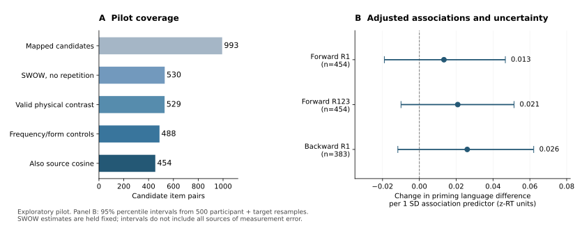

# 中英联想—启动 pilot：已完成，建议调整后再决定主实验

日期：2026-10-18。阶段：探索性pilot。决策：**adjust。数据与处理流程可用，但目前不建议按“联想变化解释跨语言启动变化”的原路径直接扩大到LLM主实验。**

[首页](../README.md) · [分析前工作方案](semantic-priming-pilot-plan-2026-10-18.md) · [完整聚合结果与来源](../data/semantic-priming-pilot-2026-10-18.json) · [语义初筛逐条记录](../data/semantic-priming-semantic-screen-2026-10-18.json) · [前一轮可行性检查](semantic-priming-feasibility-2026-10-17.md)

本轮实际读取SPAML中英试次，复原汇总，检查译词，补充词频/形式控制，并完成重采样和留出预测。使用的是已有公开人类数据及作者已提供的词向量余弦；没有另跑新的LLM评分或训练语言模型。此前简单相关已知，因此本方案和结果均不作预注册或确认性证据解释。

左图为材料保留数量；右图为不同联想指标的受控系数及重采样区间，样本不同，不能按系数大小给指标排名。右图所有区间跨过零。区间将SWOW估计视作固定值，不包含全部测量误差。

## 连接与原始结果复原：通过

固定使用[SPAML v1.0.2](https://github.com/SemanticPriming/SPAML/releases/tag/v1.0.2)，按作者的`keep_participant`、`keep_target`及正确反应规则保留试次。中英文各1,000个项目、两个条件的均值与试次数，合计**4,000格全部复原一致**；最大均值差小于`5×10⁻¹⁵`。原530组的启动差也复原一致，因此前一轮接近零的相关没有发现由汇总连接错误造成的证据。[作者试次字段说明](https://github.com/SemanticPriming/SPAML/blob/master/05_Data/codebooks/codebook_priming_trials.Rmd)、[中文处理代码](https://github.com/SemanticPriming/SPAML/blob/master/05_Data/data_processing/data_processing_zh.Rmd)

| 实际范围 | 英文 | 中文 |
| --- | ---: | ---: |
| 下载试次文件全部行数 | 842,031 | 123,225 |
| 按上述规则保留试次 | 711,045 | 99,366 |
| 保留试次涉及参与者 | 5,121 | 729 |
| 严格529组pilot内的不重复物理试次 | 377,232 | 52,188 |

**复原发布表不等于验证物理观测和条件独立。**追加试次编号审计发现：中文“右边→左边”有45个原始事件编号同时带两种条件标签；其中34个保留事件被列为相关/无关两行。对应候选ID251的两条件提示词也都为“右边”，不能形成所需的中文对照。本轮隔离这1组并重跑；**严格pilot保留529组、516个中文目标词，分析内没有重复物理事件编号。**中文原文件还有其他重复编号行，位于已排除的歧义词对范围内，未自动修改原文件或将复原计数当成独立事件总数。

严格样本中45组的中文目标在完整材料中存在重复译词，仍需分组处理。原7条未决映射均涉及多个英文形式汇入相同中文词对，本轮维持未决，没有通过改配对增加样本。前一轮“530组”是词面覆盖/非重复目标启动的计数，不是本轮追加事件审计后的可分析量。

## 语义对应初筛：尚未通过正式材料验收

固定种子20261018，从原530组随机抽60组，仅查看材料文字，不按项目的启动或联想数值选择。**助手单轮初筛：38组核心译义基本相容、18组义项/范围/词类敏感、4组明显需要独立复核。**这不是人类金标准，也不是全库误译率估计。

| 来源材料例子 | 初筛发现 |
| --- | --- |
| `look → watch` / 看见→手表 | watch的动作义与器物义不同；中文可能改变原词对最容易激活的关系。手表本身是合法译义，不能由此断定所有参与者都采用动词义。[词典义项](https://dictionary.cambridge.org/dictionary/english-chinese-simplified/watch) |
| `smile → laugh` / 微笑→开心 | 目标从发笑行为变为情绪状态，相关概念并非同一概念。[词典说明](https://dictionary.cambridge.org/dictionary/english-chinese-simplified/laugh) |
| `urgent → emergency` / 紧急→迫切 | emergency的事件/状况义没有由“迫切”保留。[词典说明](https://dictionary.cambridge.org/dictionary/english-chinese-simplified/emergency) |
| `nickname → surname` / 昵称→姓名 | surname指姓氏，“姓名”范围更广。[词典说明](https://dictionary.cambridge.org/us/dictionary/english/surname) |
| `relative → cousin` / 亲戚→表哥 | 增加了性别、年龄及亲属分支限制，属于词汇化范围问题，不自动当作错误删除。 |

核心疑似不等价项另参照词典出版方的检索索引正文；网页直接读取返回403，没有把检索索引当作浏览器整页验收。词典可核对义项区分，不能替代实验参与者的义项判断。4组标签均保留为待独立裁定。

这些例子说明，“词对关系发生变化”可能同时包含真实联想差异、词义选择与翻译粒度变化。当前材料还不能将三者分开。**数值pilot没有把未抽查的470组自动标成合格，也没有只删除已看到的问题来制造更好的结果。**

## 补充控制后的主要结果：未获得稳定支持

主要结果变量仍为同一译词组的“中文启动差−英文启动差”；主要预测量为两种语言SWOW R1有向联想条件差的变化。控制每种语言的目标词频、提示词频差、目标字数、提示词长度差、字符集合重合差，并加入作者的fastText余弦条件差。两个语言的控制系数分别估计，余弦不按绝对值作跨语言语义标尺。

词频使用[wordfreq 3.1.1](https://github.com/rspeer/wordfreq/tree/912caf64b657478d1dff1138efdc078947d54bb1)。它是约2021年以前的多源频率快照；中文分词及跨来源构成仍有限制。被分成多个词元的项目不把组合频率当成该词的已知词频，也不将缺失余弦补零。严格529组中488组有完整词频/形式控制，454组另有两语言完整余弦，主模型含441个中文目标词组。

500次重采样同时纳入各参与者在所选材料中的全部试次和中文目标词分组，重新计算启动并拟合模型。下表区间是条件于现有SWOW估计的95%百分位区间，**没有完全传播联想常模误差及共有提示词的交叉依赖**。

| 固定检查 | n | 系数：z反应时单位／1SD联想差 | 重采样95%区间 |
| --- | ---: | ---: | --- |
| **主要：首次反应R1** | **454** | **0.0133** | **[−0.0190, 0.0467]** |
| 仅词频/形式控制，不加作者余弦 | 488 | 0.0132 | [−0.0188, 0.0438] |
| 另排除所有完整材料中的重复中文目标 | 411 | 0.0123 | [−0.0238, 0.0494] |
| 三次反应R123敏感性检查 | 454 | 0.0208 | [−0.0100, 0.0514] |
| 反向联想敏感性检查 | 383 | 0.0260 | [−0.0117, 0.0621] |

只按中文目标词作常规聚类区间时，R123的下界略高于零；同时纳入参与者采样后，上述区间均跨零。因此不能从其中挑选一个结果宣布假设成立，也不能据此宣告联想作用为零。R123和反向指标各自的样本、量尺与主要指标不同。主要系数另用R的线性回归独立重算，得到相同的0.01334456。

严格529组首次反应的简单相关为r=−0.020；改用原始毫秒启动差为r=0.008。另进行50次等试次数诊断：对每项目四个“语言×条件”取共同最小试次数（中位数45、最小12）无放回抽样，相关中位数为−0.017，重抽分布的2.5%—97.5%范围为[−0.054, 0.017]。这是下采样结果分布，不是总体置信区间，也不代表下采样提高了测量精度。

## 留出预测：收益很小

先按中文目标词成组做5折预测；标准化只在训练折拟合，岭回归惩罚固定为1，没有搜索最佳模型。普通分组仍有共享提示词及跨角色重复词，故进一步对**主要R1模型**逐折移除任何与测试词相同的训练词项。固定分组排除后每折剩197—218组训练材料，且已检查同一语言内三个词槽的训练/测试词面交集为空。

| 验证范围（454组；R²） | 词频/形式＋分布基线 | 基线＋直接联想 | 加联想的ΔR² |
| --- | ---: | ---: | ---: |
| 固定目标词5折 | −0.02222 | −0.02359 | −0.00137 |
| 固定5折，另排除共享词 | −0.12332 | −0.12461 | −0.00129 |
| 10次固定种子分组并排除共享词，平均 | −0.03809 | −0.04124 | −0.00315 |

隔离1条条件歧义改变了分割成员，固定分割成绩波动较大，故增加分割敏感性检查：固定种子20261018至20261027，汇报全部10次，不选最好的一次。3次增加联想后R²略升、7次下降，平均ΔR²为−0.00315；10次联想模型的留出R²均低于零。同一批材料的重复分割不是10个独立实验，分割间分布也不是总体置信区间。固定词汇排除分组下，训练均值预测R²为0.00128，优于两种回归模型。

词汇排除解决的是每折词面重复，不能保证义项、语素、语义类别或任务之间的泛化。这里比较的是固定的统计预测模型，不是新LLM性能；没有将不能稳定预测推广为所有模型均不可能预测。

## 测量稳定性：两类任务需要分开看

本轮在严格529组上按参与者随机分半100次，再作Spearman–Brown换算：

| 测量 | 英文 | 中文 | 跨语言差值 |
| --- | ---: | ---: | ---: |
| 人类识别启动 | 0.658 | 0.497 | **0.447** |
| SWOW R1联想条件差 | 0.965 | 0.925 | **0.936** |

这些是当前材料集合、分半方法与发布样本内的稳定性估计。不能与前一轮作者在完整材料、不同分半规则下存档的可靠性作无条件比较。SWOW共有零边可能提高一致性，未观察到的联想仍不能解释为总体没有；本轮没有用这组可靠性数字作机械去衰减。

联想指标可以稳定计算，启动的跨语言差值更不稳定。这支持先修订材料与效应测量，而不是把更多模型数量当成解决办法；它仍不能确定接近零的对应究竟来自哪一种心理机制。

## 本轮决策与结果—主张边界

| 核查问题 | 证据 | 当前判断 |
| --- | --- | --- |
| 数据能否正确接合、复原？ | 4,000格复原一致；隔离条件歧义后529组可计算 | 通过技术可行性，保留资格限制 |
| 是否可视为同一批等价概念？ | 随机60组有18组义项敏感、4组疑似不等价，未有独立人工复核 | 未通过正式材料验收 |
| 联想差异是否有稳健新增解释？ | 主要受控区间跨零，词汇排除后的预测收益很小 | 目前支持不足 |
| 能否据此判断文化、双语主导或人机共同机制？ | 语言内任务、不同人群、观察性来源 | 当前资料不识别 |

**建议保留处理流程，暂不按原路径扩大实验。**若继续，应先明确要研究“同义项的联想差异”还是“翻译时义项/词汇化改变的后果”，二者需要不同材料。前者要独立审核对齐概念；后者要把义项和关系变化本身变成有定义、可复核的预测量，而不能继续混在一个翻译键里。随后再判断现有启动任务是否提供足够稳定的结果变量。

这不构成“跨语言语义或LLM研究不可做”的判断。它把下一步成本集中到可识别的问题上：继续增加模型，尚没有解决当前语义和测量限制的依据。

## 执行记录与可复算范围

已有先例与贡献边界沿用[上一轮证据矩阵](semantic-priming-feasibility-2026-10-17.md#证据与剩余空间)，本轮没有用一个正结果重新包装首创性。工作方案在本轮控制模型运行前写下，但已知上一轮结果。执行中增加的有限检查包括：移除重复目标、物理事件资格审计、词汇排除与分割敏感性，以及SWOW自身的分半稳定性；主要预测量和结果变量未改变。首次530/455试算由事件审计后的529/454结果替代，全文数值采用后者。

公开材料只包括报告、60组初筛的ID/判断、聚合统计、来源哈希和代码。SWOW反应表、逐项目联想值和参与者数组均留在本地，未上传GitHub。主要处理脚本：

- [试次复原、材料与控制量提取](../scripts/semantic_priming_pilot_prepare.py)
- [重采样、固定模型与分组/词汇排除预测](../scripts/semantic_priming_pilot_analyze.py)
- [SWOW参与者分半诊断](../scripts/semantic_priming_pilot_norm_reliability.py)
- [从聚合结果绘制独立图形](../scripts/semantic_priming_pilot_figure.py)

完整输入文件名、SHA-256、软件版本和每折样本量保留在[聚合结果JSON](../data/semantic-priming-pilot-2026-10-18.json)。仍需自行领取受许可约束的SWOW原表；脚本不绕过该访问流程。语义审读不是可自动替代的人类验收步骤。
